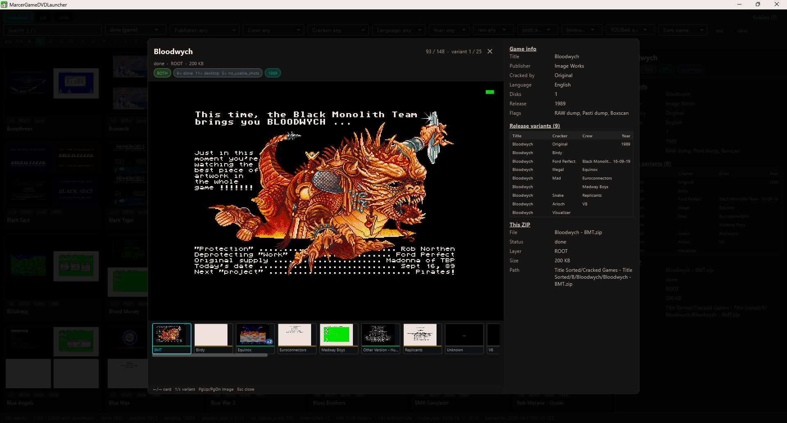

# Marcer GameDVD

Tools and apps for browsing and launching the [Marcer GameDVD](https://www.facebook.com/groups/360493904888475/) Atari ST game archive.

The primary application is the **Flutter desktop app** — a gallery-style inventory browser with metadata and screenshot previews. A legacy **console launcher** (C#) and a set of Python maintenance tools round out the monorepo.

---

## 🗂️ Applications

| App | Path | Tag | Description |
|---|---|---|---|
| **Desktop app** (primary) | [`apps/marcer_desktop`](apps/marcer_desktop/README.md) | `desktop-v*` | Flutter desktop app: gallery-style catalog grid, game info, screenshots, lightbox, optional folder browser. |
| Console launcher (legacy) | [`apps/marcer_console`](apps/marcer_console/README.md) | `v*` | Keyboard-driven terminal UI over the same archive; launches ZIPs in Hatari. |

Both are strictly **read-only** consumers of the archive and its derived artifacts.

---

## 🖥️ Desktop App (Flutter)

**Browse the whole GameDVD archive like a gallery — screenshots, metadata and a
full-screen viewer, driven entirely by the keyboard.** It is a windowed
master-detail browser (Surface A; a fullscreen couch mode, Surface B, is
planned) built with Flutter, and a strictly **read-only** consumer of the
archive and its derived artifacts — except `favorites.txt` and, on explicit
Save, the manual screenshot curation described below.




### ✨ Features

- **Gallery-style catalog grid** as the default view — every game as a card
  with its best screenshot, section tabs (`games` / `pd` / `utils`; `games`
  is the former `cracked` section) and
  global filters: search, status, publisher, crew, cracker, language, year,
  tri-state `raw` / `pasti` / `boxscan`, `TOS/Bad`, and a combined sort
  dropdown (`name asc` … `crew desc`, same width as `TOS/Bad`).
- **Type-to-filter facet dropdowns** — start typing to jump to a publisher,
  crew, cracker, language or year. The open menu spans ¾ of the screen
  height; reopening a facet after picking an entry jumps to exactly that
  entry (while typing, the partial match filter works as before).
- **Gallery-style detail sidebar** — Game info, the full Release-variants
  table (the open ZIP highlighted) and a "This ZIP" table (File, Status,
  **Kind**, Layer, Size, Path).
- **Crew / cracker focus** — pick a crew or cracker and each card jumps to
  *that group's* ZIP variant, even when it has no screenshot yet (fuzzy
  matching tolerates `&`/`and` and small typos).
- **Clickable groups** — clicking a crew/cracker in the detail sidebar (or
  the lightbox info panel) opens that group's ZIP in the lightbox; when no
  ZIP matches, the lightbox opens with a "… ZIP not found —" hint.
- **Full-screen lightbox** — integer-upscaled pixel-art-safe image, variant
  filmstrip with `+N` candidate badges, a scrollbar and a **favorite star on
  every thumb** (`★` favorited, `☆` on the active variant — click or `*` to
  toggle), candidate strip and the release-variant table; `←/→` cards,
  `↑/↓` variants, `PgUp/PgDn` images, `M` promote the shown candidate to the
  main image, `C` edit the shown variant's status/kind.
- **Optional folder browser** (`T`) — the overlay tree (main + patch layer)
  with layer labels and the virtual `Favorites` folder.
- **Multi-variant cards** — a 2×2 grid of screenshots when a folder has
  several ZIPs; if exactly one of them is a game screenshot (`done`), the
  large game preview is shown instead.
- **Gallery-style status bar** — with-screenshot ratio, status counts (ZIP
  entries of `index.json`), matched folder count, `index.json` mtime and
  gameinfo generation time.
- **Status filter** — `with screenshot` / `any` / `done` / `desktop` /
  `desktop text` / `desktop black` / `pending` / … . `pending` is
  **app-specific**: it matches a game when **at least one** of its ZIPs is
  pending (the gallery's aggregated card status would hide pending ZIPs
  inside otherwise-done folders); every other status value uses the
  gallery's card aggregation. Note the different units: the status bar
  counts ZIP entries, the filter counts games — `pending 5` in the bar can
  therefore mean fewer games.
- **Launch with Hatari** — start the selected ZIP in the emulator (`P` in the
  list/grid, `Space`/`P` in the lightbox, or the **(P)lay** button in the
  detail sidebar). Argument template with `{cfg}`/`{zip}` substitution and the
  bundled `MarcerGameDvd-Hatari.cfg` fallback; non-blocking.
- **Favorites** (`*` on the selected ZIP/card, in the detail panel or on a
  filmstrip star) with `FAVORITE` badges, the virtual `Favorites` folder in
  the browser view and a **★ Favorites** filter that lists your favorite
  games of **all** sections at once (status and facets are ignored there, the
  text search stays active). A card counts as favorite as soon as **any** of
  its ZIPs is starred, and launching it plays that starred ZIP when exactly
  one variant is favorited; pd/utils cards resolve their folder ZIPs on
  demand, so they can be starred and launched like cracked games. Persisted
  per section tree as `favorites.txt` (one absolute path per line —
  `Patch/<section tree>/favorites.txt`, the same format and location the
  console launcher uses, so both apps share their favorites; without a
  `PatchDirectory` each section gets `favorites-<section>.txt` next to the
  executable). A legacy single `favorites.txt` (`PatchDirectory` →
  application directory → CWD) is still read, and entries that belong to
  another OS (e.g. Windows `Y:\…` lines in a shared file) are preserved on
  save but not shown.
- **Manual screenshot curation** — `M` in the lightbox swaps the currently
  viewed candidate with the variant's main image (fixed file names, only the
  PNG contents trade places); the grid card, detail view, filmstrip and
  candidate strips refresh immediately (per-path image version keys, so only
  the swapped files re-decode). `C` (lightbox/detail view) changes a ZIP's
  `status`/`kind` in memory. Changes accumulate in a pending list; a cyan
  **Save (n)** button (left of the update badge) writes them to `index.json`
  and the per-entry meta under the screenshot-gen lock (a running
  `shotgen.py` blocks the write). The status filter gains **`desktop text`**
  and **`desktop black`** — strictly `status: desktop` entries whose kind is
  `textscreen`/`darkscreen` (the plain `desktop` entry keeps showing every
  kind).
- **Degrades gracefully** — missing `index.json` or gameinfo data simply shows
  empty states instead of crashing.
- **Self-update** (release builds) — silent check against the GitHub
  `desktop-v*` releases after startup; when a newer version exists, an amber
  `⬆ <version>` button appears left of the Folders button. Click to download
  the platform ZIP, swap it in place (user config, favorites and `TOS.IMG`
  are never touched) and restart the app automatically. Failures show a
  dialog; leftover `*.old` files are cleaned up on the next start. On
  Windows the swap runs in a hidden helper after the app exits (the running
  app locks its mapped libraries `data\app.so` / `flutter_windows.dll`;
  the helper's steps are logged to `MarcerUpdater.log` next to the app).
  Dev runs (`run.sh`) never check.

### 🚀 Quick start

1. **Download** the ZIP for your platform from the
   [Releases](https://github.com/skoelle/marcer-gamedvd-launcher/releases) page
   and extract it.
2. **Configure** — copy the shipped `desktop.config.example.json` next to the
   executable (or the `.app`), rename it to `desktop.config.json`, and set your
   absolute paths (at minimum `RootDirectory`). See *Configuration* below.
3. **Run** `MarcerGameDVDLauncher` (`MarcerGameDVDLauncher.exe` /
   `MarcerGameDVDLauncher.app`).

Without a config the app opens a page listing the folders it searched.

### 📥 Download

Download the ZIP for your platform from the [Releases](https://github.com/skoelle/marcer-gamedvd-launcher/releases) page:

| Platform | Archive |
|---|---|
| Windows | `MarcerDesktop-*-win-x64.zip` |
| Linux | `MarcerDesktop-*-linux-x64.zip` |
| macOS | `MarcerDesktop-*-osx-arm64.zip` |

The release ZIPs ship `desktop.config.example.json` **and** the bundled
`MarcerGameDvd-Hatari.cfg` — copy the example next to the executable (or the
`.app`), rename it to `desktop.config.json`, and set your absolute paths. For
launching, also point `Hatari.Executable` at your Hatari binary and put
`TOS.IMG` next to the app.

### ⚙️ Configuration (`desktop.config.json`)

The app looks for `desktop.config.json` in this order (first existing wins):

1. current working directory
2. the directory of the executable (portable ZIP release)
3. macOS only: the folder containing the `.app` bundle

Without a config the app shows a page listing the searched locations. Template: [`apps/marcer_desktop/desktop.config.example.json`](apps/marcer_desktop/desktop.config.example.json).

| Field | Required | Notes |
|---|---|---|
| `RootDirectory` | yes | game root; navigation never leaves it |
| `PatchDirectory` | no | empty/missing ⇒ no patch layer |
| `OutDirectory` | no | screenshot archive (`index.json`, PNGs) |
| `DataDirectory` | no | gameinfo JSONs; default `<Patch>/../Data` |
| `Hatari.Executable` | for launch | path to the Hatari binary (relative resolves against the app dir) |
| `Hatari.ConfigFile` | no | Hatari config; empty ⇒ the bundled `MarcerGameDvd-Hatari.cfg` is used |
| `Hatari.ArgsTemplate` | no | argument template; must contain `{cfg}` and `{zip}` (default `-c "{cfg}" --disk-a "{zip}"`) |
| `ShowCandidates` | no | candidate thumb strip on grid cards (default `true`) |
| `DefaultStatus` | no | initial status preset (default `with_screenshot`) |
| `Window.width/height` | no | initial window size and restore size (default 1280×800) |
| `Window.maximized` | no | start the window maximized (default `true`; `false` ⇒ `width`×`height`, centered) |

### ⌨️ Keyboard shortcuts

| Key | Action |
|---|---|
| `↑` / `↓` | Move the selection (one row in grid view) |
| `←` / `→` | Move the selection left / right (grid) |
| `PgUp` / `PgDn` | Jump one page up / down |
| `Enter` / `→` | Open the folder / show the lightbox |
| `Backspace` | Parent directory (in catalog view: clear filters) |
| `*` | Toggle favorite on the selected ZIP / catalog card (for a card: its single starred variant, else the launch ZIP; also in the detail panel and on the lightbox's shown variant / filmstrip star) |
| `M` | Lightbox only, on a candidate image: swap it with the variant's main image (`<base>.png`) |
| `C` | Lightbox/detail view: change the shown ZIP's status/kind (pending until **Save (n)**) |
| `P` | Launch the selected ZIP with Hatari |
| `/` | Focus the search field |
| `T` | Toggle catalog grid / folder view |
| `?` | Show the help overlay |
| `ESC` / `q` | Exit |

In the **lightbox**: `←`/`→` switch card, `↑`/`↓` switch variant, `PgUp`/`PgDn`
switch image, `Space`/`P` launch the shown ZIP (the favorited ZIP of that card
when exactly one variant is starred), `*` favorite the shown variant (or click
a filmstrip star), `M` make the shown candidate the main image, `C` edit
status/kind, `Esc` closes.

> **Manual curation & shotgen compatibility** — `M` is an immediate file swap
> (no index write; names never change). `C` changes stay in memory until the
> **Save (n)** button writes them atomically (tmp + rename) while holding the
> `shotgen.lock` PID lock; a live screenshot-gen run blocks the save. Entries
> saved as `done` are never touched by later shotgen passes; `desktop`
> entries can still be re-classified by `shotgen reclassify` (which re-reads
> the preview image) — pick `done` when a manual kind should stick.

> **Launching** needs `Hatari.Executable` in `desktop.config.json` and a TOS ROM
> (`TOS.IMG`) next to the app — same convention as the console launcher; the
> bundled `MarcerGameDvd-Hatari.cfg` looks for it in the working directory.

### 🛠️ Build & Run (developers)

Requires the Flutter stable SDK in `~/flutter` plus the Linux desktop toolchain (`clang cmake ninja-build pkg-config libgtk-3-dev liblzma-dev`).

```sh
export PATH="$HOME/flutter/bin:$PATH"
apps/marcer_desktop/run.sh                      # run app (linux desktop)
cd apps/marcer_desktop/packages/marcer_catalog && dart test   # data-layer unit tests
cd apps/marcer_desktop && flutter test          # app unit tests
cd apps/marcer_desktop && flutter analyze       # lint
```

`run.sh` seeds a git-ignored `desktop.config.json` from `local/paths.env` on first start.

---

## ⌨️ Console Launcher (legacy)

A fast, keyboard-driven terminal launcher for the Hatari emulator, still shipped for CLI users and CI-free environments. It uses `launcher.config.json` and the same overlay/patch semantics as the desktop app.

**Full documentation, configuration and controls: [`apps/marcer_console/README.md`](apps/marcer_console/README.md).**

Build & run via the platform scripts (only needed when changing `apps/marcer_console/`):

```bat
apps\marcer_console\build.cmd
apps\marcer_console\start.cmd
```

```bash
apps/marcer_console/build.sh
apps/marcer_console/start.sh
```

> ⚠️ Do **not** use `dotnet build` or `dotnet run` directly — always use the platform build script.

---

## 🔧 Tools

Helper tools for maintaining and enriching the game archive (not part of either app's release ZIP). Python scripts run via their `run.sh` wrapper with the repo `.venv`; paths come exclusively from the git-ignored `local/paths.env`.

| Tool | Purpose | Docs |
|---|---|---|
| [`tools/gameinfo-gen`](tools/gameinfo-gen/README.md) | Extracts game metadata (publisher, cracker, year, language, dump flags, …) from the GameDVD XLS workbooks into JSON under `MARCER_DATA_DIR`. | [`tools/gameinfo-gen/README.md`](tools/gameinfo-gen/README.md), [`ANALYSIS-game-data.md`](docs/ANALYSIS-game-data.md) |
| [`tools/gallery`](tools/gallery/README.md) | Interactive gallery webapp over the screenshot archive (`MARCER_OUT_DIR`) joined with game metadata (`MARCER_DATA_DIR`). | [`tools/gallery/README.md`](tools/gallery/README.md), [`SPEC-gallery-webapp.md`](docs/SPEC-gallery-webapp.md) |
| [`tools/screenshot-gen`](tools/screenshot-gen/README.md) | Boots every ZIP in Hatari on a virtual display and captures preview screenshots into `MARCER_OUT_DIR`; entry kinds are `game`, `desktop`, `textscreen`, `darkscreen`,
`no_game_image` (offline `reclassify` pass; drive-LED resets re-captured via
`run --retry-drive-led`; entries ending as `no_usable_shots` keep the earlier captures as `_cNN` candidates — gated on `keep_candidates` — and use the last capture as preview). | [`tools/screenshot-gen/README.md`](tools/screenshot-gen/README.md), [`SPEC-screenshot-generator.md`](docs/SPEC-screenshot-generator.md) |

---

## 🚀 Release Process

Releases are automated via GitHub Actions. This is a monorepo with **one tag scheme per app** so each app is built and released independently:

| App | Tag scheme | Workflow | Artifacts |
|---|---|---|---|
| Console launcher (`apps/marcer_console/`) | `vX.Y.Z` (e.g. `v0.9.8`) | [`release.yml`](.github/workflows/release.yml) | `MarcerGameDvdConsole-v…-{win,linux,osx}-x64.zip` |
| Flutter desktop (`apps/marcer_desktop/`) | `desktop-vX.Y.Z` (e.g. `desktop-v0.1.0`) | [`desktop-release.yml`](.github/workflows/desktop-release.yml) | `MarcerDesktop-v…-{win,linux,osx}-x64.zip` |

Each workflow triggers only on its own tag prefix (`v*` never matches `desktop-v*` and vice versa), so a desktop release never rebuilds the console launcher and the other way around. Path-based CI (build + test on `main` and PRs, **no release**) runs only when the relevant app changed: [`ci-launcher.yml`](.github/workflows/ci-launcher.yml) for `apps/marcer_console/**`, [`ci-desktop.yml`](.github/workflows/ci-desktop.yml) for `apps/marcer_desktop/**`.

**To create a release:**

You can use the `/create-release` command (via opencode) for a fully automated flow:

```text
/create-release 1.0.0            # console launcher → v1.0.0
/create-release desktop 0.1.0    # Flutter desktop  → desktop-v0.1.0
```

This command validates the version, checks for uncommitted changes, generates a release summary from recent commits, creates a release commit with the summary as the commit message, tags it, and pushes — all in one step. The matching GitHub Action then builds platform ZIPs and creates the GitHub Release.

**Manual release:**
1. Ensure `README.md` and `AGENTS.md` are up to date.
2. Commit all changes.
3. Tag and push (console example):
   ```bash
   git tag v1.2.3
   git push origin v1.2.3
   ```
   Desktop example:
   ```bash
   git tag desktop-v0.1.0
   git push origin desktop-v0.1.0
   ```
4. The matching workflow builds platform ZIPs, generates release notes, and creates a GitHub Release.

---

## 📝 Notes

- Full technical requirements and build rules are in [`AGENTS.md`](AGENTS.md).
- After any functional change, both `README.md` and `AGENTS.md` must be updated.
- Every release **must** include release notes listing all changes and bugfixes.

---

## 📚 Documentation

The design and specification documents live in [`docs/`](docs/README.md):

| Document | Contents |
|---|---|
| [`docs/SPEC.md`](docs/SPEC.md) | Technology-neutral behavioral specification of the launcher (overlay rules, navigation, rendering, launch) — the basis for reimplementing it in any language. |
| [`docs/ANALYSIS-game-data.md`](docs/ANALYSIS-game-data.md) | Analysis of the external game metadata sources (XLS workbooks, data model, matching, roadmap). |
| [`docs/ANALYSIS-boxscan-manual-structure.md`](docs/ANALYSIS-boxscan-manual-structure.md) | Analysis of the `Boxscan/` and `Manual/` companion folders (location, naming, ZIP/loose-file structure, edge cases, consumer requirements). |
| [`docs/DECISION-app-architecture.md`](docs/DECISION-app-architecture.md) | Why the desktop app is Flutter, the gallery webapp is Python + HTML, and the couch surface is planned. |
| [`docs/SPEC-gallery-webapp.md`](docs/SPEC-gallery-webapp.md) | Behavioral spec of the gallery webapp (`tools/gallery`) — the design reference for the desktop catalog. |
| [`docs/SPEC-screenshot-generator.md`](docs/SPEC-screenshot-generator.md) | Screenshot pipeline and the `index.json` artifact consumed by both UIs. |
| [`docs/BUGS.md`](docs/BUGS.md) | Known issues and their resolution status. |

Per-app/per-tool docs stay next to their code: [`apps/marcer_desktop/README.md`](apps/marcer_desktop/README.md), [`apps/marcer_console/README.md`](apps/marcer_console/README.md), and each `tools/*/README.md`.

---

## License

Licensed under the [MIT License](LICENSE) - Copyright (c) 2026 Stefan Koelle (https://stefankoelle.de)
