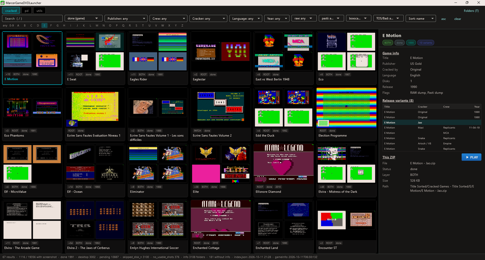

# Marcer GameDVD Desktop App (Flutter, Surface A)

Inventory browser for the Marcer GameDVD archive: windowed master-detail UI,
gameinfo metadata, screenshot previews, **Marcer's curated box scans &
manuals**, gallery-style global filters with a
**catalog grid as the default view** (section tabs, search, facets incl.
genre/developer/publisher/crew/cracker, sort, **★ Favorites**) and a
gallery-style detail sidebar
(Game info + This ZIP + Release variants); an optional overlay folder
browser (`T` / Folders button) per `SPEC.md` §7, plus a gallery-style
lightbox (filmstrip + info panel). On desktop, **scrollbars stay visible**
whenever a view overflows. **Read-only** consumer of all data roots except
favorites and, on explicit Save, manual screenshot curation.

All filter dropdowns (facets, status, sort, raw/pasti/boxscan, TOS/Bad) are
**virtualized** — only the visible rows are built — with a type-to-filter field
and `↑`/`↓` + `Enter` navigation, so opening them with ~1,000 entries stays
instant. The filter bar rebuilds only when a filter changes, not on selection
moves or background scan notifications.



Plan: [`PLAN.md`](PLAN.md). Architecture decision:
[`DECISION-app-architecture.md`](../../docs/DECISION-app-architecture.md).

## Structure

- `packages/marcer_catalog/` — pure Dart data layer (overlay merge, gameinfo
  join, screenshot index, `GameCard` universe + facets + filter/sort engine,
  config). No Flutter dependency; unit-tested via `dart test`.
- `lib/` — Flutter app (gallery catalog grid, optional folder browser,
  list/grid entry views, lightbox with a gallery-style status bar). The
  catalog loads in a background isolate that reports progress on the loading
  screen (`Loading screenshot index…`, `Loading game metadata…`,
  `Building catalog — cracked 1200/8000…`, `Finalizing…`).
- `assets/icon/app_icon.png` — master app icon; `tool/generate_icons.py`
  regenerates the platform icon sets from the gallery favicon.
- `desktop.config.example.json` — config template (absolute paths).
  Real `desktop.config.json` is git-ignored.
- `MarcerGameDvd-Hatari.cfg` — bundled Hatari config, shipped next to the
  executable and used when `Hatari.ConfigFile` is empty (launch fallback).
- `run.sh` — **regenerates** `desktop.config.json` from
  `../../local/paths.env` on every run (all path/FTP/Hatari values are
  overwritten, so manual config edits are lost), then `flutter run -d linux`.

The executable / app bundle is named **`MarcerGameDVDLauncher`**
(`MarcerGameDVDLauncher.exe` on Windows, `MarcerGameDVDLauncher.app` on
macOS); the Dart package name stays `marcer_desktop`.

## Prerequisites

- Flutter SDK (stable) in `~/flutter` (`export PATH="$HOME/flutter/bin:$PATH"`)
- Linux desktop toolchain: `clang cmake ninja-build pkg-config libgtk-3-dev liblzma-dev`
- Data roots reachable (see `local/paths.env`): game tree, patch tree,
  screenshot archive (`index.json`, `index-pd.json`, `index-utils.json`,
  `index-magazine.json`, `index-falcon.json` + PNGs), gameinfo `Data/` dir.
  All optional — missing artifacts degrade to empty states.

## Commands

```sh
export PATH="$HOME/flutter/bin:$PATH"
./run.sh                          # run app (linux desktop)
cd packages/marcer_catalog && dart test   # data-layer unit tests
flutter test                      # app unit tests
flutter analyze                   # lint
dart run tool/benchmark.dart      # catalog data-layer benchmark (real artifacts)
../../.venv/bin/python tool/generate_icons.py   # regenerate app icons
```

## Self-update

Release builds check the GitHub `desktop-v*` releases after startup and show
an amber `⬆ <version>` badge when a newer version exists. Clicking it downloads
the platform ZIP, swaps the bundle in place (user config, favorites and
`TOS.IMG` are untouched) and relaunches the app.

On Linux/macOS the new binary is started detached and the app waits until the
OS has spawned it before exiting; Windows uses the two-phase Task Scheduler
helper. If an update ever leaves no window, start the app once manually — the
new version is already installed, and `*.old` leftovers are removed on the next
start.

## macOS

The app is **not sandboxed** on macOS (`macos/Runner/*.entitlements`): it reads
game archives from arbitrary directories, writes `favorites.txt`/`index.json`
next to the data, launches Hatari and self-updates its own `.app` — none of which
the App Sandbox permits. `lib/main.dart` calls
`FilePicker.skipEntitlementsChecks()` so the native picker works without the
user-selected entitlement. See
[`docs/DECISION-macos-distribution.md`](../../docs/DECISION-macos-distribution.md).

- **Protected folders:** macOS still guards `~/Downloads`, `~/Documents`,
  `~/Desktop` and external/network volumes via TCC. The first access shows a
  system prompt (grant it); until then the path fails with
  `Operation not permitted`. Paths outside those folders (e.g. `~/Games`) work
  directly.
- **Gatekeeper:** the release build is ad-hoc signed and **not notarized**, so a
  downloaded ZIP is quarantined. Open it once via **right-click → Open**, or run
  `xattr -dr com.apple.quarantine /path/to/MarcerGameDVDLauncher.app`.
- **App Translocation:** if you run the app straight from the unzipped folder
  while it is still quarantined, macOS runs it from a randomized read-only copy.
  Quit it, then **drag the `.app` individually in Finder** out of the unzipped
  folder into a normal folder (e.g. `~/Applications` or your home folder — not
  Downloads/Documents/Desktop) and reopen it. Only a Finder move (not `mv`, not
  moving the whole folder) ends translocation. The app shows a hint when it
  detects this.
- **Downloaded artifacts and the config live outside the bundle:** Hatari, the
  TOS ROM **and** a fallback `desktop.config.json` are written into
  `~/Library/Application Support/MarcerGameDVDLauncher/` (not inside the `.app`),
  so the app stays usable even while translocated. Self-update and favorites
  without a `PatchDirectory` still need the app moved to a writable location.

## Config (`desktop.config.json`)

The app looks for `desktop.config.json` in this order (first existing wins):

1. current working directory
2. the directory of the executable (portable ZIP release)
3. macOS only: the folder containing the `.app` bundle
4. macOS only: `~/Library/Application Support/MarcerGameDVDLauncher`

A new config (first-run setup) is written to the first **writable** of those
locations, so on a read-only/translocated `.app` it falls back to the per-user
data directory. The setup page shows the candidate locations.

The release ZIPs ship `desktop.config.example.json` — copy it next to the
executable (or the `.app`), rename it to `desktop.config.json`, and set your
absolute paths. Without a config the app opens the first-run setup page.

The setup/settings form lays the fields out as: **RootDirectory**,
**PatchDirectory**, the **FTP** server (used both for game-folder downloads
and for the catalog-data downloads), then **ScreenshotDirectory** and
**GameinfoDirectory** — each with a **Download from FTP** button next to
*Browse…* — then the **AtariLegendDirectory** with a **Download AtariLegend
data** button, and finally the Hatari settings plus the **Hatari installation**
and **TOS ROM** rows (download/install on demand, see below).

| Field | Required | Notes |
|---|---|---|
| `RootDirectory` | yes | game root; navigation never leaves it |
| `PatchDirectory` | no | empty/missing ⇒ no patch layer |
| `ScreenshotDirectory` | no | screenshot archive (`index.json`/`index-pd.json`/`index-utils.json`/`index-magazine.json`/`index-falcon.json`, PNGs) |
| `GameinfoDirectory` | no | gameinfo JSONs (no implicit fallback; fill it or download) |
| `AtariLegendDirectory` | no | compact AtariLegend cache (`atarilegend.json`); filled by **Download AtariLegend data** (directory created when missing) |
| `Hatari.Executable` | for launch | Hatari binary; relative resolves against the app dir |
| `Hatari.ConfigFile` | no | empty ⇒ bundled `MarcerGameDvd-Hatari.cfg` |
| `Hatari.ArgsTemplate` | no | must contain `{cfg}` and `{zip}` |
| `Ftp.Host` | for download | FTP server for "Download missing" and the catalog assets; `host` or `host:port` (default port 21) |
| `Ftp.User` / `Ftp.Password` | no | FTP credentials (empty user ⇒ `anonymous`; password stored in plaintext) |
| `Ftp.RemoteBase` | no | remote prefix of the game folders (default `/GameDVD/`; empty ⇒ FTP login root) |
| `Ftp.AssetsRemote` | no | remote dir of the catalog asset archives, `screenshots-*.zip` / `gameinfo-*.zip` (default `/Uploads/MarcerGameDVDLauncher-assets/`) |
| `ShowCandidates` | no | candidate thumb strip on grid cards (default `true`) |
| `DefaultStatus` | no | initial status preset for **all** sections (default `with_screenshot`) |
| `Window.width/height` | no | initial/restore window size (default 1280×800) |
| `Window.maximized` | no | start maximized (default `true`; Windows first fills the primary display's work area synchronously, then maximizes; `false` ⇒ `width`×`height`, centered, clamped to the work area) |

## Launch (Hatari)

Press `P` (list/grid), `Space`/`P` (lightbox) or the **(P)lay** button in the
detail sidebar to start the selected ZIP in Hatari. Arguments are built from
`Hatari.ArgsTemplate` with literal `{cfg}`/`{zip}` substitution (no shell);
`{cfg}` falls back to the bundled `MarcerGameDvd-Hatari.cfg` (searched in the
same locations as the config) when `Hatari.ConfigFile` is empty. Launching is
**non-blocking** — the status bar shows a "Hatari is running…" indicator and
errors appear as a modal (missing executable, vanished ZIP, …). The bundled
config expects a TOS ROM (`TOS.IMG`) next to the app (in the executable
directory, which is Hatari's working directory), matching the console launcher.

The **PLAY** button is a split button: the main part launches the default
variant, the arrow opens a menu of variants (detail sidebar and lightbox; `P` /
`Space` use the default). Built-in variants:

| Variant | Extra Hatari args | TOS |
|---|---|---|
| Standard | – | `TOS.IMG` (1.04) |
| Mono | `--monitor mono` | `TOS.IMG` (1.04) |
| STE | `--machine ste` | `TOS162.IMG` (1.62) |
| Low Res TOS 1.02 | – | `TOS102.IMG` (1.02) |
| Low Res TOS 1.00 | – | `TOS100.IMG` (1.00) |

The extra args are appended after `Hatari.ArgsTemplate` (Hatari CLI overrides
the config file). Variants with a TOS file download it on demand (see below).

A card whose index variant carries a non-default `tos` (e.g. `1.02`, written by
the screenshot generator's TOS retry for old titles that hang on TOS 1.04)
shows a **`TOS 1.02`** badge (grid tile, detail panel, lightbox header) and a
**TOS** row in "This ZIP". The primary Play action (`P` / `Space` / Play button)
then **preselects the matching variant** (Low Res TOS 1.02), so the default
Standard attempt is skipped; the dropdown still lets you choose another variant.

### Falcon 030

The `falcon` section (`Falcon 030/Title Sorted`) is a different machine and
**never uses the ST `Hatari.ArgsTemplate`/config**. It boots
`--machine falcon` with its own TOS 4.04 (`Falcon.TosFile`, default
`TOS404.IMG`; the pre-launch guard offers the download), 14 MB, `--dsp emu`,
Videl RGB and CPU 16 MHz. Because most Falcon titles are GEMDOS hard-disk
archives, the ZIP is inspected: a floppy-image ZIP goes to `--disk-a`, while a
GEMDOS ZIP is extracted into a session temp directory and autostarted with
`-d <dir>` + `--auto C:\<PROG>` and the floppy drives off
(`--drive-a off --drive-b off`, otherwise Falcon TOS 4.04 blocks the start
with a "Drive A: is not responding" dialog). The boot program is picked by
name / numbered-set lowest part (STZip self-extractors skipped) / largest; a
floppy-image ZIP goes to `--disk-a`, two images mount as drive A and B.
The Play dropdown offers Falcon variants: **RGB** (default), **VGA**
(`--monitor vga`), **4 MB** (`--memsize 4`), **DSP off** (`--dsp none`) and
**FPU** (`--fpu 68882`). Optional `Falcon` config block in `desktop.config.json`:
`TosFile`, `Memsize`, `Monitor`, `Dsp`, `CpuClock`, `Fpu`, `ExtraArgs`.
`ExtraArgs` defaults to **`--vdi off`**, so extended VDI stays disabled; set it
to an empty string to restore Hatari's default.

### Magazine GEMDOS cover disks

ST-Computer cover disks are GEMDOS file collections, not floppy images. The
magazine section detects this at launch (`lib/st_gemdos_launcher.dart`) and
starts them like Falcon GEMDOS titles but with the ST machine/config: the ZIP
is extracted and its largest program autostarted with `-d` + `--auto` (floppy
drives off). Real floppy cover disks (ST Action, The One, Zero, Start Micro)
keep the normal `--disk-a` path.

## Hatari (download & install)

When no Hatari executable is configured/found, the app offers to install a
prebuilt Hatari instead of failing at launch: before the first start an install
dialog appears (the ⚙ settings editor also has a **Hatari installation** row
with the current status and an **Install Hatari…**/**Reinstall Hatari…**
button). The pinned release (**2.6.1**) is downloaded from the official
[SourceForge project](https://www.hatari-emu.org/) — prebuilt Windows (x64) and
macOS (universal, x86-64 + arm64) archives — and unpacked into `<appDir>/hatari`
(Windows/Linux) or `~/Library/Application Support/MarcerGameDVDLauncher/hatari`
(macOS, outside the `.app` bundle); the executable is located inside the archive
(Windows `hatari.exe` / macOS `Hatari.app/Contents/MacOS/Hatari`), made
executable and, on macOS, stripped of the download quarantine. The resulting
path is written to `Hatari.Executable` — relative to the app directory on the
portable Windows/Linux layout (so the folder keeps working after being moved),
absolute on macOS (where it lives outside the bundle) — and the running catalog
updates in place.

- **Linux has no official prebuilt binary** — the row/dialog point to a manual
  (system package) install instead; the normal launch error surfaces until
  `Hatari.Executable` is set.
- Hatari is free software (GPL-2.0); nothing is bundled, only downloaded on
  demand.
- The install directory is not part of the release ZIP, so a self-update never
  overwrites it.

## TOS ROM

When `TOS.IMG` is missing, the app offers to download it instead of failing at
launch: before the first start the **TOS ROM** dialog appears (and the ⚙
settings editor has a **TOS ROM** row in the Hatari section with the current
status). It offers
the TOS **1.04** **English (UK)** and **German** images — English (UK) before
Deutsch; the default is **English (UK) — TOS 1.04**. The chosen ZIP is fetched
on demand from
[atariworld.org/tos-rom](https://www.atariworld.org/tos-rom/) (nothing is
bundled; the images are Atari-copyrighted and offered there for
non-commercial use), the ROM is extracted and written as `TOS.IMG` into the
data directory — `<appDir>` on Windows/Linux,
`~/Library/Application Support/MarcerGameDVDLauncher` on macOS — which is
Hatari's working directory (the bundled config looks for `TOS.IMG` there). The
**STE** Play variant needs **TOS 1.62** (`TOS162.IMG`), the **Low Res TOS
1.02** variant **TOS 1.02** (`TOS102.IMG`) and the **Low Res TOS 1.00**
variant **TOS 1.00** (`TOS100.IMG`) — each offered filtered to that version
when the file is missing. The **Falcon** section needs **TOS 4.04**
(`TOS404.IMG`, Multilanguage) and offers it filtered to that version as well.
The ⚙ settings editor's **TOS ROM** row reflects
only `TOS.IMG`; the variant TOS files
(`TOS162.IMG`/`TOS102.IMG`/`TOS100.IMG`/`TOS404.IMG`) are managed by the Play
variants / the Falcon section (a
missing one is offered when that variant is launched).

## Favorites

`*` favorites the selected ZIP/catalog card (also from the detail panel and
from the ★/☆ star on every lightbox filmstrip thumb). A card shows as
favorite as soon as **any** of its ZIPs is starred; the **★ Favorites**
filter lists the favorites of the **active section** (facets and status are
ignored there, the text search stays active). The folder browser shows one
virtual `Favorites` folder per section that has favorites
(`Favorites (games)`, `Favorites (pd)`, `Favorites (utils)`,
`Favorites (magazine)`, `Favorites (falcon)`). Cards without raw variants
(pd/utils) resolve their folder ZIPs on demand, so they can be starred and
launched like cracked games. Launching a favorited card plays the starred ZIP
when exactly one variant is favorited.

Storage (one root-relative POSIX path per line, same portable format as the
console launcher):

- with a patch layer: `<Patch>/<section tree>/favorites.txt` per section
  (e.g. `Patch/Title Sorted/Cracked Games - Title Sorted/favorites.txt`) —
  the console launcher uses the same relative format in
  `<Patch>/favorites.txt`; paths outside any section tree go to
  `<Patch>/favorites.txt`.
- without a patch layer: `favorites-<section>.txt` next to the executable
  (misc paths → `favorites.txt`).
- legacy absolute paths (Windows `Y:\…`, Linux `/mnt/…`) are read and
  rewritten relative on startup. The first migration creates a timestamped
  `.bak-*` backup of every rewritten file; unresolvable foreign lines are
  preserved verbatim but not shown.

## Keyboard & mouse

`?` opens the in-app help overlay from the catalog, folder list and lightbox.
The lightbox uses `←/→` for cards, `↑/↓` for variants, `PgUp/PgDn` for images,
`Space`/`P` to launch, `*` to favorite, `M` to promote the shown candidate,
`C` to edit status/kind, `Esc` to close and `?` for help. Mouse controls:
filmstrip thumbnails switch variants, their stars toggle favorites, the
candidate strip selects an image, AtariLegend / Box scans / Manuals chips open
their dialogs, and the ROOT/PATCH folder icons open the game folder in the OS
file manager.

## Status filter

The status dropdown (`with screenshot`, `any`, `done`, `desktop (only)`,
`desktop (any ZIP)`, `desktop text`, `desktop black`, `pending`,
`no usable shots (only)`, `no usable shots (any ZIP)`, `interrupted`,
`skipped (disk 2+)`) is available in **all five sections** (cracked, pd,
utils, magazine, falcon):

- `pending`, `desktop (any ZIP)` and `no usable shots (any ZIP)` match a
  game when **at least one** of its ZIPs has that status.
- `desktop (only)` and `no usable shots (only)` use the aggregated card
  status (`done → desktop → no usable shots → interrupted → pending →
  skipped`), i.e. they exclude folders that also have a higher-priority
  status.
- `interrupted` and `skipped (disk 2+)` also match when **at least one**
  ZIP has that status, so a `done` folder containing a failed/skipped ZIP
  remains reachable.
- `done` uses the aggregated card status. `desktop text`/`desktop black`
  are strict per-ZIP kind filters.
- The default is `with screenshot` for **all** sections; change `DefaultStatus` in
  `desktop.config.json` to use another preset on startup and after section switches.

Card previews follow the active status filter: `with screenshot`, `any` and
`done` keep the done-first preview; `desktop`/`no usable shots` and the other
concrete statuses show that status first. With ≥2 previews the 2×2 variant
grid is used (no single-done exception under a concrete status filter), with
the selected status as the first tile; a single-preview card shows the
selected status image (falling back to the done/desktop preview).

The status bar reports every status as **games (ZIPs)** (see below), so the
games number always equals the result count of the matching dropdown
selection.

## Status bar

The gray bar at the bottom shows the current view path (folder browser),
result/entry counts, the gallery-style status info and — right aligned —
the **running app version** (`v…`; release builds: stamped from the
`desktop-v*` git tag via `--build-name`, dev builds: the pubspec version).

Status info in catalog mode is **section-aware** (same `games (ZIPs)` format
as the gallery's statistics bar, plus the folder total; the gallery labels
the coverage `info N folders` / `N without info`):

- `3287 folders` — games (cards) of the active section; cracked cards are
  built from `index.json`, pd/utils cards are the union of their own
  index (`index-pd.json` / `index-utils.json`) and gameinfo-only folders,
  magazine cards come from `index-magazine.json` (one card per issue,
  filename-derived) and falcon cards from `index-falcon.json`; every game
  folder with at least one ZIP is one card.
- `3211 with screenshot` — games of the section with a preview (prefer
  `done` game shot, else first `done`, else first `desktop`).
- `done 2635 (8979 zips)` — per status: number of **games** (cards) plus
  their **ZIP entries** in parentheses, counted for the active section.
  The games number equals the result count of the matching status dropdown
  selection. `desktop`/`no usable shots` count the aggregated card status;
  the corresponding `any ZIP` segments are shown when they differ and count
  every card with at least one such ZIP. `pending` likewise counts any
  pending ZIP, so a game can appear in multiple segments at once.
- `gameinfo N folders`, `N without gameinfo` — gameinfo match coverage
  (`N` cracked folders matched by the gameinfo generator, `manifest.json`
  `matched_folders`; cracked only) / cards of the active section whose
  gameinfo join is empty.
- `index.json: …` (or `index-pd.json` / `index-utils.json` /
  `index-magazine.json` / `index-falcon.json` for those sections),
  `gameinfo: …` — active index mtime and gameinfo generation timestamp.

## Missing ZIPs

The catalog is built from the screenshot index + gameinfo **without any
filesystem scan**, so it also lists games/ZIPs that are not synced locally
yet. The app therefore resolves ZIP existence **and** the displayed
`ROOT`/`PATCH`/`BOTH` layer on demand from the actual filesystem (cached), so
a ZIP moved between layers still shows where it really lives, and it marks
absent files:

- **`MISSING` card badge** (grid tile, detail panel, lightbox header) when
  **none** of the card's ZIPs exists in either `RootDirectory` or
  `PatchDirectory` — such a card cannot be launched.
- **Per-variant `MISSING`** in the lightbox filmstrip (red tag) and the
  "This ZIP" table (`Missing` row) when that specific ZIP is absent, while
  other variants of the same card are present.

A card with at least one local ZIP is not marked, even if some variants are
missing. The check is cached per session; files that appear or vanish while
the app runs are re-evaluated after a download or a settings reload.

**The grid never blocks on the filesystem.** Building a tile only reads the
cached layer/missing state and requests a background scan of the card's
folder(s) (bounded concurrency, one directory listing per folder instead of
per-file `stat` calls); the `ROOT`/`PATCH`/`BOTH` and `MISSING` badges appear as
soon as the scan result lands. This keeps scrolling smooth on slow/network
mounts. The detail panel and launch path use the same cache (a fresh selection
triggers the scan on demand).

The offline data-layer benchmark against the real artifacts is
`dart run tool/benchmark.dart` (see [Commands](#commands)).

## Box scans & manuals

The hand-curated `Boxscan/` and `Manual/` folders shipped with the Marcer
archive are a **first-class feature** — the collector-grade scans and manuals
are discovered **lazily** for the selected card only (no index, no tree scan)
and displayed in-app; the app never modifies these files. A background isolate
checks both layers for child folders named
`boxscan`/`box scan`/`manual`/`manuals` (case-insensitive) and lists their loose
files and ZIP central directories. Nothing is extracted until you open
something.

- The **Box scans (N)** / **Manuals (N)** chips at the top of the Game-info
  panel (detail sidebar **and** lightbox) appear when assets exist.
- **Box scans:** gallery grouped by edition (ZIP stem / edition folder) with
  bounded thumbnails; a thumbnail opens the full-screen viewer (`←/→`, `Esc`,
  zoom). Recursive in-ZIP images are supported; PDFs/disk images inside
  `Boxscan/` are ignored.
- **Manuals:** grouped by stem; scan/text pairs (`<stem>.zip` /
  `<stem>_text.zip`) are both offered. PDFs and `.doc`/`.txt` open in the OS
  default application, image-page manuals open in the image viewer, `.msa` files
  are shown as info-only disk images (never opened as documents).
- Both layers are merged (patch wins for the same path); hidden entries
  (`@eaDir`, dotfiles) are skipped and vanished/unreadable folders are treated
  as empty. The XLS `boxscan` filter flag stays independent metadata.
- ZIP media is extracted on demand into a session temp cache under
  `<system temp>/marcer_local_assets_<pid>/` (only ZIP contents are copied —
  loose files are used in place); **nothing is deleted automatically** and
  nothing is persisted across runs (the OS may clean its temp directory on its
  own). Background: [`docs/ANALYSIS-boxscan-manual-structure.md`](../../docs/ANALYSIS-boxscan-manual-structure.md).

## Open the game folder

The card header in the detail sidebar and the lightbox header show folder
icons for the selected card, but only for layers where the folder exists:

- **ROOT** (grey) opens the card's folder in the main tree.
- **PATCH** (amber) opens the patch copy (only when `PatchDirectory` is
  configured).

No icon is shown when the card's folder is missing in that layer; a failed
launch is reported in a snackbar. The folder opens in the OS file manager
(`open` on macOS, `explorer` on Windows, `xdg-open` on Linux).

## Download missing (FTP)

A card that has no local ZIP (red `MISSING` badge) can be pulled from the
Marcer FTP server without leaving the app: the detail sidebar shows a
**Download folder** button next to the `MISSING` badge that downloads the
card's whole folder recursively (all ZIP variants and subdirectories) into the
patch layer — or the root directory when `PatchDirectory` is empty — and then
re-checks the local layer so the `MISSING` badge disappears.

Connection settings live in the same `desktop.config.json` under `Ftp` and are
edited in the ⚙ settings editor:

- `Ftp.Host` — FTP server as `host` or `host:port` (port 21 by default, so a
  non-standard port is given inline, e.g. `ftp.example.com:2121`). While the
  host is empty the button shows a "FTP not configured" hint instead of
  downloading.
- `Ftp.User` / `Ftp.Password` — credentials (an empty user connects as
  `anonymous`; the password is stored in plaintext in the config file).
- `Ftp.RemoteBase` — remote directory prefix, default `/GameDVD/` (the game
  folders are looked up as `<RemoteBase>/<section tree>/<letter>/<folder>`).
  Leave it empty when the FTP login directory is already the catalog root.

The transfer always runs in **binary FTP** mode (ASCII would corrupt the ZIP
files).

Existing local files are skipped, so an interrupted run can simply be repeated.
The sidebar and the status bar show progress and a **Cancel** button; failures
appear as a modal. The download runs in the background (non-blocking, one at a
time), so browsing stays responsive.

## Catalog data (Download from FTP)

The catalog is built from the screenshot index and the gameinfo JSONs; without
them the catalog is empty. `ScreenshotDirectory` contains the generated **ZIP
boot-state previews** (loaders, desktops, text screens, …), not AtariLegend
images; see *Screenshots: actual ZIP boot state* in the root README. AtariLegend's
curated screenshots are separate and only appear in the AtariLegend dialog.
The setup/settings form therefore puts a **Download
from FTP** button next to *Browse…* on both `ScreenshotDirectory` and
`GameinfoDirectory`:

- the newest `screenshots-*.zip` is fetched from `Ftp.AssetsRemote` and
  extracted into `ScreenshotDirectory`, the newest `gameinfo-*.zip` into
  `GameinfoDirectory`.
- uploads never overwrite, so the newest archive is picked by the
  `yyyyMMdd-HHmmss` timestamp in its name; the two archives must both be present
  in the asset directory.
- after a successful download the applied archive is recorded in
  `<targetDir>/.marcer-assets.json`; clicking **Download from FTP** again when
  the newest archive is already applied (and its data is present) reports
  **"Already up to date"** and offers a **Download anyway** dialog instead of
  re-downloading.
- `Ftp.Host` and the target directory are required (the target directory is
  created when missing); progress and **Cancel** show inline, failures as a
  SnackBar.
- the transfer forces **binary FTP** mode (ASCII would corrupt the ZIPs) and a
  post-download size check rejects truncated transfers.
- the ZIP is extracted in a **background isolate** showing file-count progress
  (`Extracting 1234/8000 files…`, the screenshot archive holds thousands of
  PNGs), so the UI stays responsive and the run can be cancelled; a crashed
  extractor fails with an error instead of hanging.
- while a download/extraction runs, **Save**, **Cancel** and **Exit** are
  disabled (and the dialog cannot be dismissed) so the transfer is not
  interrupted; use the inline **Cancel** in the progress row to stop it.
- `Ftp.AssetsRemote` defaults to `/Uploads/MarcerGameDVDLauncher-assets/` — set it
  in the form (or config) when the assets live elsewhere.

`GameinfoDirectory` has **no implicit fallback**: if it is empty no gameinfo is
loaded.

## AtariLegend data (metadata enrichment)

The weekly [AtariLegend](https://www.atarilegend.com/) database dump adds
metadata the archive does not have (genre, developer, original credits,
release data). The app **never ships or bundles** this data (license
CC BY-NC-SA 4.0); it is fetched on demand:

- the setup/settings form has an **AtariLegendDirectory** path directly below
  *GameinfoDirectory* with a **Download AtariLegend data** button next to
  *Browse…*.
- the button resolves the newest `YYYY-MM-DD.sql.gz` from the AtariLegend
  dump directory, downloads it, decompresses it (gzip) and parses only the
  needed tables in a **background isolate**, then writes the compact cache
  `atarilegend.json` (game id/name/slug, release year, publisher, genres,
  conversion/original system, developers/authors with roles, aliases, plus the
  **screenshot/boxscan references**) and the separate **`atarilegend-texts.json`**
  (reviews, comments, magazine references, ~1.2 MB). The downloaded `.sql.gz`
  is **deleted** afterwards.
- the target directory is created when missing; progress and **Cancel** show
  inline, failures as a SnackBar.
- while the fetch runs, **Save**, **Cancel** and **Exit** are disabled (and the
  dialog cannot be dismissed).
- the metadata cache is ~4.4 MB for ~6.200 games; the text cache (~1.2 MB) is
  **loaded lazily** the first time a Reviews/Magazines/Comments tab is opened
  (kept for the session).
- at startup the cache is read and each catalog card's **folder name** is
  matched against the AtariLegend titles (aliases included; exact → prefix →
  fuzzy; **Falcon cards are included**, magazine cover-disk cards are not).
  When matched, the detail sidebar and the lightbox show a teal
  **AtariLegend** button at the top-right of the *Game info* heading (also on
  *No game info*). It opens an in-app dialog with the cached metadata
  (year, publisher, genres, conversion/original system, developers and authors
  **one per line with their roles**, e.g. `Taito`/`Arcade`,
  `Tatsumi`/`Game Conversion`, `Jas C Brooke`/`Music`) and an **Open on
  atarilegend.com** button (external browser, `url_launcher`). The AKA titles
  (`Speed Buggy` for Buggy Boy) are used for matching too.
- the dialog is **tabbed**: **Info** (metadata/credits — Developers/Authors in
  an aligned **3-column grid**, name above its role — **and** Boxscans +
  Screenshots **at the same time**, no hero image). The Info header shows the
  **community score** far right (`4.11 / 5`, `7 votes`; average of
  `game_votes` normalized to /5) and the **publisher + developer logos** side
  by side in the middle (hotlinked from `companies.imgext`), **Reviews (N)**
  (date, scores, BBCode-rendered text, review link), **Magazines (N)** (issue,
  page, score, archive.org link) and **Comments (N)** (text + date). The
  `(N)` counts come from the metadata cache, so they are visible immediately.
- images are hotlinked (nothing bundled); a thumbnail opens a full-size viewer
  (`←`/`→`, `Esc`, zoom). The text data loads lazily on the first text tab.
- the dump excludes the `users` table, so **reviews/comments show no author
  names** (text/score/date only); the review/magazine links open the website.
- **After updating from an older build, click Download AtariLegend data once
  again**: cache schema **v5** adds the **community score** and the
  publisher/developer **logo references** (v4 added the review/comment/magazine
  counts, v3 the image references, v2 the roles/conversion/release-AKA aliases)
  and the new `atarilegend-texts.json` provides reviews/comments/magazines.
  Older caches still load but lack those fields and show an "outdated" warning.
- the filter bar has **Genre** (after the status dropdown) and **Developers**
  (after Publisher) dropdowns fed by the cache — **both are hidden until
  AtariLegend data is loaded**; the **Publisher** dropdown and
  match merge gameinfo and AtariLegend publishers (case-insensitive). An
  **author** filter is not implemented (AtariLegend data is shown in the
  dialog only) — see
  [`../../docs/ANALYSIS-atarilegend.md`](../../docs/ANALYSIS-atarilegend.md).

## Catalog-data update check

After the (release-only) app self-update check, a silent startup check fetches
the small `latest.json` pointer published by `tools/asset-manifest` from the
GitHub `catalog-latest` prerelease — **GitHub only, never the FTP** (the FTP is
contacted only when you actually update). A gray **dataset** icon button sits in
the top bar (always available, right of the version badge) and shows a small
green count badge when updates are pending.

Clicking it opens the **Catalog data** dialog, listing **game info first, then
screenshots** with the local and remote archive names and per asset:

- **Update** (or **Install** when nothing is applied yet) — downloads the newest
  archive from the FTP and extracts it; progress and **Cancel** show inline.
  When the extracted data is present but the applied version is unknown (no
  `.marcer-assets.json`) the row shows **version unknown (data present)** and the
  button is **Overwrite**.
- **Skip this version** — the remote archive is recorded in
  `<targetDir>/.marcer-assets.json` under `skipped`, so you are only notified
  again when a newer archive appears (cleared automatically once applied).
- **Close** at the bottom.

An asset counts as up to date only when the recorded archive matches the remote
**and** the extracted data is still present, so a deleted/emptied target
directory is offered again.

If the pointer provides a `sha256`, the downloaded archive is verified against
it; a mismatch aborts the update. After a successful update the catalog reloads
in place.

## Catalog coverage

Conversely, a ZIP that exists in your `RootDirectory`/`PatchDirectory` but is
in **neither** the screenshot index nor gameinfo does **not** appear in the
catalog at all — the catalog is artifact-driven, not a tree listing. Such files
are only reachable in the folder browser (`T`); regenerate the artifacts
(`shotgen index`, `gameinfo-gen extract`) to bring them into the catalog. The
displayed `ROOT`/`PATCH`/`BOTH` layer is always resolved from your own copy
(see above), never from the published index. See
[`docs/DECISION-catalog-data-source.md`](../../docs/DECISION-catalog-data-source.md).

When a section has **no** cards because the artifacts are missing, a banner
explains what is missing and points to the settings **Download from FTP** (and
the status filter `any`). Loading is robust: a malformed/truncated
`games-*.json` is skipped with a warning instead of aborting the whole catalog,
and a load failure shows an error screen with **Retry**/**Settings…** instead of
hanging on the loading spinner.

## License

MIT License — Copyright (c) 2026 Stefan Koelle (https://stefankoelle.de)
